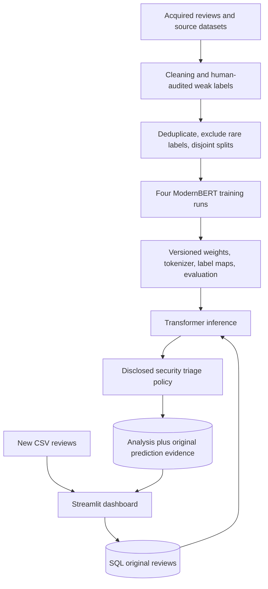

# Financial Feedback Intelligence — transformer-only

Analyze financial-app reviews with four separately fine-tuned **ModernBERT** classifiers: sentiment, intent, suspected root cause, and risk band. Streamlit imports CSV reviews, processes them on demand, and stores original reviews and linked analysis in SQL.

**Status:** training/deployment source is provided. There are currently **no verified deployable model exports bundled with this release**. The older root-cause checkpoint has 26 outputs but the available encoder has 25 labels. It is deliberately excluded; retraining from the base model with the new manifest is required. No TF-IDF/Logistic Regression/Ridge website model is included or used. No accuracy claim is made for the revised transformers before training and evaluation.

## Start here: choose the right path

| Your starting point | What to run |
|---|---|
| No trained exports | Acquire data → prepare/audit labels → train/evaluate all four transformers → configure exports → start app |
| Four complete compatible exports from this exact workflow | Skip research notebooks; install runtime dependencies → configure exports → preflight → start app |
| Only the older checkpoints | Do not deploy them. Restore their exact original label provenance or use the supported fresh-training path |

`app.py` can display setup instructions without models, but **cannot analyze reviews until all four valid exports are configured**. A company using already trained exports does not retrain notebooks for every installation or every new review.

## Architecture



The risk model predicts an **ordinal band**, not continuous loss. The displayed score is a probability-weighted band midpoint; explicit security rules can raise triage priority. Rules are not proof of fraud and execute no account actions. Details and limitations: [evidence and policy](docs/EVIDENCE_AND_POLICY.md).

## 1. Environment

Use Python **3.11 or 3.12**, from the repository root. Keep the same environment for notebooks and Streamlit.

```powershell
python -m venv .venv
.\.venv\Scripts\Activate.ps1
python -m pip install --upgrade pip
# CPU example; for NVIDIA CUDA use the official PyTorch installer selector.
python -m pip install torch --index-url https://download.pytorch.org/whl/cpu
python -m pip install -r requirements-training.txt
python -m pip install -r requirements-dev.txt
python -m ipykernel install --user --name finsentiment --display-name "FinSentiment"
python -m jupyterlab
```

For deployment with existing exports, install `requirements.txt` instead of training requirements. Select **FinSentiment** as the notebook kernel. GPU training is recommended; CPU can be very slow. Use [PyTorch's official selector](https://pytorch.org/get-started/locally/) for a CUDA-compatible install. Dependencies are a documented target, not a claim that a complete fresh GPU training run has been verified. Save `python -m pip freeze > training-environment.txt` with each experiment; exports also record core package versions.

## 2. Research execution order

Numbering is retained to match the original research. There is no notebook 6; notebook 9's classical baseline is excluded from this transformer-only release.

| Order | File | Input / output and purpose |
|---:|---|---|
| 1 | `1_download.py` | Downloads Banking77 and preserves label names in `data/raw` |
| 2 | `2_scraper.ipynb` | Scrapes configured apps; saves raw reviews and combined data. Check data rights and provenance |
| 3 | `3_data_audit_clean.ipynb` | Cleans Banking77, PhraseBank and scraped app files into `data/processed` |
| 4 | `4_Taxonomy_and_Labeling.ipynb` | Applies `taxonomy.json` via external labelers; produces versioned v3 CSV/checkpoints. Requires private API keys and review-data permission |
| Gate | Human label audit | Review security, negation, mixed issues, closure/refund cases and a random sample. Correct labels before training; weak labels are not ground truth |
| 5 | `5_mapping_audit_datasets.ipynb` | Builds model-ready task datasets, exclusion reports, encoders and dataset manifest |
| 7 (optional) | `7_dataset_analysis.ipynb` | Descriptive class/token analysis; does not set production token limits |
| 8 | `8_tokenization.ipynb` | Predeclared max lengths; compact labels; deterministic train/validation/test splits; exact tokenizer and schema-2 manifests |
| 10 | `10_transformer_training.ipynb` | Run setup and each task's train/evaluate cells; exports four timestamped model folders |

Restart kernels for complete runs. Run from the repository root. Notebook 8 replaces generated tokenized task folders; back up older experiments first. The minimum of 10 examples is an exclusion/split safeguard, not evidence of sufficient accuracy. Rare categories are unsupported until enough audited examples exist. Do not manufacture duplicate examples to pass this check.

**Data acquisition is not automatic end to end:** Financial PhraseBank `data/raw/all-data.csv` must be obtained separately under its source terms (Latin-1, no header, two columns: sentiment and text). Notebook 3 expects raw files for all configured apps; change its explicit file list if your source coverage differs. See [data guide](data/README.md). API examples contain placeholders only; copy `api_keys.json.example` to private `api_keys.json`. The labeling notebook sends reviews to the configured providers and may incur usage charges. It must not be used on unapproved company data.

## 3. Train and fix the 26-versus-25 mismatch

The supported solution is **fresh fine-tuning from `answerdotai/ModernBERT-base`**, with `num_labels`, `id2label` and `label2id` generated from the retained training classes. The final root-cause class count may be neither 25 nor 26 after quality exclusions. The old 26-output trained tensor is not repaired by changing a number in config.json.

Training defaults: microbatch 8, accumulation 4 (effective batch 32 on one device), evaluation batch 8, gradient checkpointing, CUDA BF16 where supported (otherwise FP16), dynamic padding, early stopping with patience 2, best validation macro-F1, and at most two Trainer checkpoints. These are starting settings; choose hyperparameters on validation data, never the final test. Exact speed/memory gains are hardware-dependent and not benchmarked here.

Each task exports `models/transformer_exports/<task>/<timestamp>/` with weights, tokenizer, readable config, `deployment.json`, and—after the evaluation cell—`evaluation.json`. Do not split these files apart. Generic `LABEL_0` mappings, changed taxonomy hashes, wrong weight hashes, missing evaluation, and incomplete exports are rejected by the adapter. Training/evaluation remain your next required step; existing historical checkpoints are not presented as fixed models.

## 4. Select models

```powershell
Copy-Item transformer_models.example.json transformer_models.json
```

Edit the four export paths to the actual completed folders. Paths are relative to this configuration file. Set `device` to `cpu` or an available CUDA device. The default is this file in the project root; optionally set `FINSENTIMENT_MODEL_CONFIG` to a different configuration path. **There is no fallback model.**

```powershell
python scripts/preflight.py
```

The preflight validates export manifests/hashes and required packages without inference. Then run a real prediction smoke test with your exports before deployment. Model confidence is uncalibrated, and the rule layer must be evaluated separately from the learned predictions.

## 5. Database and app

For local testing, no MySQL setup is required: without `database.toml`, SQLite stores results in `runtime/reviews.sqlite3`.

For a company/MySQL deployment, first start a MySQL server, create the database and application user, then copy/configure `database.toml`. **MySQL Workbench is a client, not the database server.** XAMPP commonly supplies MariaDB; WAMP's selected server/port depends on its installation. Credentials belong to the actual server account, not the GUI product. See [MySQL/WAMP/XAMPP setup](MYSQL_SETUP.md).

```powershell
python -m streamlit run app.py
```

Import UTF-8 CSV → choose review text and a stable source ID → click **Import and analyze reviews**. First run processes all imported eligible reviews; later runs process only new ones. Results are stored for queries. No timed polling is used. Manual entry is only a test feature.

CLI one-shot alternative:

```powershell
python process_reviews.py
python process_reviews.py --retry-failed
```

Restart Streamlit after changing models or database settings. Completed records are not automatically reanalyzed when a model changes. Preserve model versions and compare new results in a separate test dataset/database rather than deleting historical records.

## Repository structure

- Numbered notebooks + `1_download.py`: research stages above.
- `training_quality.py`: normalized dedup/conflict/rare-class cleanup and split checks.
- `taxonomy.json`: canonical labels, combination matrix, action routing and provisional risk policy.
- `review_analyzer.py`: input validation only; **no trained baseline**.
- `model_backend.py`, `transformer_analyzer.py`: transformer selection, artifact validation and inference.
- `security_policy.py`, `suggestions.py`: disclosed rule adjustments and human action suggestions.
- `app.py`, `dashboard.py`: Streamlit manual test and monitoring dashboard.
- `review_store.py`, `process_reviews.py`: schema, import/dedup, claims, retries, transactional results/evidence.
- `scripts/preflight.py`: setup readiness check; `scripts/audit_checkpoint.py`: inspect head dimensions without loading weights into torch.
- `tests/`: data quality, policy, artifact validation, database pipeline and UI setup tests using synthetic data.
- `data/`, `models/`, `reports/`: instructions; private/generated artifacts are excluded by default.
- `docs/`: evidence, model status, release/retention guidance.

## Verification and limitations

Run `python -m pytest tests -q`. Unit tests do not replace model evaluation or live MySQL integration tests. Before production: evaluate each class, security false negatives/positives, low-confidence cases, independent human labels and held-out app/time data. Current random splits prevent normalized exact-text overlap but do not guarantee near-duplicate/user/time independence.

No secrets, private review CSVs, optimizer checkpoints, old incompatible weights, or alternative website model bundles are part of this release. Publication replaces the current GitHub file tree through a normal commit and preserves history. Large verified transformer weights should be distributed with Git LFS or a model release after training; see [model guide](models/README.md).
