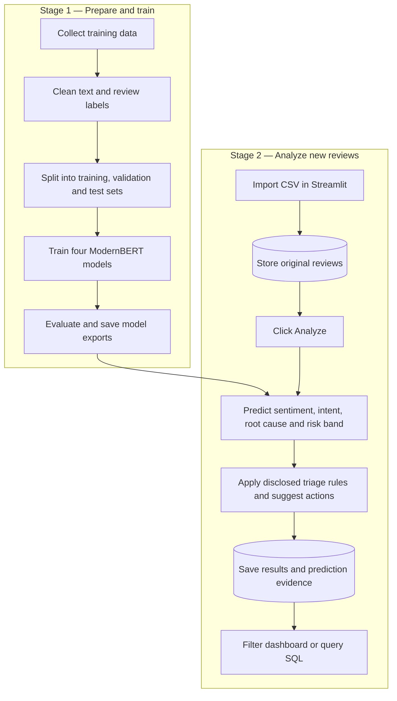

# Financial Feedback Intelligence System

A review-analysis application for financial services. It uses **ModernBERT transformer models** to understand customer feedback and a **Streamlit dashboard** to help teams find reviews that need attention.

Import a CSV, analyze its reviews when needed, and keep the original reviews and results in a database for filtering and SQL queries.

## What the project provides

| Output | What it tells you |
|---|---|
| Sentiment | Whether the review is positive, negative, neutral or mixed |
| Intent | The customer's request or reported problem |
| Suspected root cause | A likely issue category inferred from the review |
| Risk band and score | A priority estimate for reviewing the issue |
| Confidence | Model confidence for classification outputs |
| Suggested action | A proposed next step and responsible team for human review |
| Processing details | Status, processing time, model version and completion time |

The dashboard supports:

- CSV import with duplicate prevention and preservation of original columns.
- On-demand analysis: process all imported reviews first, then only newly eligible reviews.
- Filters for risk, sentiment, intent, processing status and review date.
- Failure records, retries and recovery after interrupted processing.
- Optional manual review entry for testing.
- MySQL storage, or SQLite for a simpler local setup.

**Before you start:** this repository contains the training and application code. Training data and trained model weights are not bundled. A fresh installation must prepare data, train and evaluate all four models, and configure their export paths before it can analyze reviews. If you already have compatible exports produced by this workflow, you can skip training.

## Contents

- [How it works](#how-it-works)
- [Requirements](#requirements)
- [1. Clone and install](#1-clone-and-install)
- [2. Prepare the training data](#2-prepare-the-training-data)
- [3. Run the notebooks in order](#3-run-the-notebooks-in-order)
- [4. Train and evaluate the models](#4-train-and-evaluate-the-models)
- [5. Connect the models to the website](#5-connect-the-models-to-the-website)
- [6. Choose and configure storage](#6-choose-and-configure-storage)
- [7. Start and use the website](#7-start-and-use-the-website)
- [Project files and when to use them](#project-files-and-when-to-use-them)
- [Troubleshooting](#troubleshooting)
- [Testing and limitations](#testing-and-limitations)

## How it works

The project has two stages. **Training prepares the models. Running the application uses those models on new reviews.** You do not retrain for every new CSV.



### Prediction logic

1. The saved tokenizer converts a review into input tokens for each task.
2. Four separately trained ModernBERT classifiers predict sentiment, intent, suspected root cause and risk band.
3. Class probabilities provide confidence and alternative labels.
4. The risk-band probabilities are converted into a displayed score from 0 to 10 using the configured band representatives.
5. Security-triage rules can raise priority for explicit incident reports. When a rule changes a result, the original model prediction is retained and the change is identified.
6. Action suggestions route the review to a team for human assessment. The application does not perform account actions.

The score is a **triage estimate**, not a probability of fraud or financial loss. A suspected root cause is inferred from text, not verified against banking systems. See [the method and policy explanation](docs/EVIDENCE_AND_POLICY.md) for the assumptions and references.

### Storage logic

| Table | Stores |
|---|---|
| `reviews` | Original review text, source ID, dates and imported CSV fields |
| `review_analysis` | Predictions, confidence, suggested action, processing status and model version |
| `review_analysis_evidence` | Supporting prediction details and any security-policy adjustment |

Analysis records link to the original review ID. Reimporting the same source and stable ID does not overwrite the original review. Completed and invalid reviews are skipped on later analysis runs; failed reviews have a separate retry option.

## Requirements

- Git and Python **3.11 or 3.12**.
- Internet access for package installation, dataset/model downloads and external labeling.
- An NVIDIA GPU is recommended for training. CPU execution is supported but training can be slow. Available memory determines usable batch sizes.
- Training datasets described below.
- A Groq or Gemini API key for the supplied labeling notebook.
- Optional: a running MySQL server for database storage. SQLite requires no separate server.

Run commands and notebooks from the **project root**—the folder containing `app.py`. Use the same Python environment for Jupyter and Streamlit.

## 1. Clone and install

### Windows PowerShell

```powershell
git clone https://github.com/Amal-Anojan/Financial-Feedback-Intelligence-System-Using-NLP.git
cd Financial-Feedback-Intelligence-System-Using-NLP

python -m venv .venv
.\.venv\Scripts\Activate.ps1
python -m pip install --upgrade pip
```

If PowerShell prevents activation, use `.\.venv\Scripts\python.exe` instead of `python` in the commands below.

### macOS or Linux

```bash
git clone https://github.com/Amal-Anojan/Financial-Feedback-Intelligence-System-Using-NLP.git
cd Financial-Feedback-Intelligence-System-Using-NLP

python3 -m venv .venv
source .venv/bin/activate
python -m pip install --upgrade pip
```

### Install PyTorch and project packages

Choose the appropriate CPU or CUDA installation command from the [official PyTorch installer](https://pytorch.org/get-started/locally/). For example, a CPU installation on Windows or Linux is:

```bash
python -m pip install torch --index-url https://download.pytorch.org/whl/cpu
```

For a fresh setup that includes training:

```bash
python -m pip install -r requirements-training.txt
python -m ipykernel install --user --name finsentiment --display-name "FinSentiment"
```

`requirements-training.txt` includes the application's runtime requirements. If you already have all four compatible model exports and only want to run the website, install `requirements.txt` instead.

## 2. Prepare the training data

The supplied research workflow combines Banking77, Financial PhraseBank and app reviews.

| Data | How to obtain it | Expected location |
|---|---|---|
| Banking77 | Run `python 1_download.py` | `data/raw/banking77_train.csv` and `banking77_test.csv` |
| Financial PhraseBank | Obtain the dataset under its source terms and prepare the expected CSV format | `data/raw/all-data.csv` |
| App reviews | Run `2_scraper.ipynb` for the configured apps | Per-app `*_raw_reviews.csv` files in `data/raw/` |

The PhraseBank input must contain **two comma-separated columns in this order: sentiment label, review text**, with no header. Notebook 3 reads it using Latin-1 encoding. If your download uses another format, convert it to this format before continuing.

Notebook 3 expects the app files listed in its loading cell. If you choose different apps, update its input list and corresponding cleaning/combination cells. Do not continue with missing input files. The [data guide](data/README.md) describes the expected fields.

### Configure the labeling API

Create your local key file:

```powershell
Copy-Item api_keys.json.example api_keys.json
```

On macOS/Linux, use `cp api_keys.json.example api_keys.json`.

Add at least one usable key in the `groq_keys` or `gemini_keys` list. Check the provider/model settings in notebook 4 for your account. Keep this file private; it is excluded from Git.

Notebook 4 sends review text to the configured external provider and may incur usage charges. Use data that you have permission to process and share with that provider. Website inference uses the saved local transformers and does not require these labeling API keys.

## 3. Run the notebooks in order

Start Jupyter from the project root:

```bash
python -m jupyterlab
```

Select the **FinSentiment** kernel. Run each required notebook from top to bottom, completing one stage before starting the next. Follow the sequence below; gaps in filenames do not indicate missing required steps.

| Step | File or activity | What it does | Result needed by the next stage |
|---:|---|---|---|
| 1 | `1_download.py` | Downloads Banking77 with readable label names | Banking77 CSVs in `data/raw/` |
| 2 | `2_scraper.ipynb` | Collects the configured app reviews | Raw app CSVs and combined reviews |
| 3 | `3_data_audit_clean.ipynb` | Audits and cleans the input datasets | Clean CSVs in `data/processed/` |
| 4 | `4_Taxonomy_and_Labeling.ipynb` | Labels reviews using `taxonomy.json` and the configured provider | `data/labeled/labeled_reviews_v3.csv` |
| 5 | Review the generated labels | Check and correct a representative sample, including security reports, negations and mixed issues | Reviewed labels suitable for training |
| 6 | `5_mapping_audit_datasets.ipynb` | Maps labels, builds task datasets and records exclusions/provenance | Task CSVs and `dataset_manifest.json` in `data/model_ready/` |
| 7, optional | `7_dataset_analysis.ipynb` | Examines class balance and text/token lengths | Descriptive reports in `reports/` |
| 8 | `8_tokenization.ipynb` | Cleans task data, creates separate splits and saves tokenized inputs | Task datasets, tokenizers and manifests in `data/tokenized/` |
| 9 | `10_transformer_training.ipynb` | Trains, evaluates and exports all four models | Complete exports in `models/transformer_exports/` |

Important data-quality behavior:

- Normalized duplicate text is kept out of different splits.
- Conflicting labels and invalid rows are excluded and recorded.
- Classes with fewer than 10 usable examples are excluded from training; their examples are not deleted from the raw data.
- Remaining class IDs are rebuilt to match the model's output labels.
- Data is split approximately **70% training / 15% validation / 15% test**.
- Exclusion reports are written under `reports/training_quality/` when the preparation notebooks run.

Review the exclusion reports: a model cannot learn a category that has been excluded. Collect more independently reviewed examples for important undersupported categories. Ten examples is a split safeguard, not a guarantee of good performance.

Restart the kernel before a complete rerun. Notebook 8 replaces its generated tokenized folders, so preserve an experiment's artifacts before rebuilding them.

## 4. Train and evaluate the models

In `10_transformer_training.ipynb`:

1. Run the setup and configuration cells.
2. Review epochs, learning rate and batch size. Reduce the batch size if memory is insufficient.
3. For **sentiment**, run its data-loading, training and evaluation cells.
4. Repeat for **intent**, **root cause** and **risk**.
5. Inspect per-class metrics and confusion matrices before using the models in the website.

Training uses validation macro-F1 to select the best checkpoint. Memory controls include gradient accumulation and gradient checkpointing; early stopping limits unnecessary epochs. Change model settings using validation results, and reserve the test set for final evaluation.

Each task creates a separate folder:

```text
models/transformer_exports/
├── sentiment/<export_timestamp>/
├── intent/<export_timestamp>/
├── root_cause/<export_timestamp>/
└── risk/<export_timestamp>/
```

Keep every export folder complete:

| File | Purpose |
|---|---|
| `model.safetensors` or weight shards | Trained model parameters |
| `config.json` | Model settings and class-label mapping |
| Tokenizer files | Convert review text into the model's expected tokens |
| `deployment.json` | Task settings, preprocessing details, versions and integrity hashes |
| `evaluation.json` | Test results created by the task's evaluation cell |

**Run the evaluation cells too.** Training alone does not create `evaluation.json`, which the application requires. Keep the tokenizer, configuration and weights from the same export together.

## 5. Connect the models to the website

Copy the model-selection template:

```powershell
Copy-Item transformer_models.example.json transformer_models.json
```

On macOS/Linux, use `cp transformer_models.example.json transformer_models.json`.

Open `transformer_models.json` and replace each placeholder with that task's actual export folder. The timestamps can differ between tasks.

```json
{
  "device": "cpu",
  "risk_score_method": "expected_band_midpoint",
  "exports": {
    "sentiment": "models/transformer_exports/sentiment/YOUR_SENTIMENT_TIMESTAMP",
    "intent": "models/transformer_exports/intent/YOUR_INTENT_TIMESTAMP",
    "root_cause": "models/transformer_exports/root_cause/YOUR_ROOT_CAUSE_TIMESTAMP",
    "risk": "models/transformer_exports/risk/YOUR_RISK_TIMESTAMP"
  }
}
```

Paths are relative to this configuration file. Use `cpu`, or `cuda` when a supported GPU and CUDA-enabled PyTorch are available. You do not need to edit `app.py` to select models.

Check setup readiness:

```bash
python scripts/preflight.py
```

Resolve any missing packages, export files or metadata mismatches before proceeding. This check validates files and configuration; it does not run predictions or test the database connection. Use the website's manual test after startup to check actual inference.

## 6. Choose and configure storage

### Option A: SQLite for local use

No server or database password is required. Leave `database.toml` absent. The application creates its local database at `runtime/reviews.sqlite3` and initializes the tables automatically.

### Option B: MySQL for shared/server storage

1. Install and start a MySQL server, or start the database service supplied by your WAMP/XAMPP installation.
2. Open Workbench, phpMyAdmin or the database command-line client as an administrator.
3. Create a database and application account using the SQL below. Replace the password placeholder.
4. Copy `database.example.toml` to `database.toml` and enter the same connection settings.
5. Start the application; it creates the review and analysis tables.

```sql
CREATE DATABASE IF NOT EXISTS finsentiment
  CHARACTER SET utf8mb4 COLLATE utf8mb4_unicode_ci;

CREATE USER IF NOT EXISTS 'finsentiment_app'@'localhost'
  IDENTIFIED BY 'REPLACE_WITH_YOUR_PASSWORD';

GRANT SELECT, INSERT, UPDATE, CREATE, REFERENCES
  ON finsentiment.* TO 'finsentiment_app'@'localhost';
```

`CREATE USER IF NOT EXISTS` does not reset the password of an existing account. Use that account's actual credentials.

```powershell
Copy-Item database.example.toml database.toml
```

On macOS/Linux, use `cp database.example.toml database.toml`.

Edit your local `database.toml`:

```toml
[database]
backend = "mysql"
host = "127.0.0.1"
port = 3306
name = "finsentiment"
user = "finsentiment_app"
password = "REPLACE_WITH_YOUR_PASSWORD"
```

**Workbench is a database-management client. The database server must also be running.** For WAMP/XAMPP, use the actual service's host, port and account credentials; the Python code stays the same. XAMPP commonly supplies MariaDB, which should be tested with your installed version. Streamlit serves the website itself, so Apache is not required to serve `app.py`.

You do not need to create tables manually or load the CSV in Workbench first. Import reviews through the dashboard after setup. For account-host details, SQL queries and troubleshooting, see [MYSQL_SETUP.md](MYSQL_SETUP.md).

## 7. Start and use the website

From the activated environment in the project root:

```bash
python -m streamlit run app.py
```

Open the local URL printed in the terminal, normally `http://localhost:8501`.

### Test a review

1. Select **Manual review test**.
2. Enter a review and click **Analyze review**.
3. Check the predictions, confidence and any rule-adjustment message.

Manual tests are not saved to the database.

### Import and analyze a CSV

Use a UTF-8 CSV with a header. For example, this synthetic sample shows the required structure:

```csv
review_id,review_text,review_date
r001,"The app is easy to use.",2026-01-10
r002,"My transfer failed but the money was deducted.",2026-01-11
```

1. Select **Review dashboard** and upload the CSV.
2. Set a consistent **source name**, such as the app or review channel.
3. Select the review-text column and a stable review-ID column.
4. Optionally select an ISO-formatted date column; otherwise import time is used.
5. Click **Import and analyze reviews**.
6. Use the dashboard filters or SQL queries to inspect saved results.

For later imports, keep the same source name and ID convention. Existing source/ID pairs are skipped; new records are imported. If you omit an ID, identical rows under the same source are treated as duplicates. Selecting a file alone does not import it—you must click the import button.

Analysis runs **when requested**, with no polling interval. To process reviews already stored in the database from the terminal:

```bash
python process_reviews.py
```

To include failed reviews in a retry run:

```bash
python process_reviews.py --retry-failed
```

Interrupted processing can resume after a 10-minute safety lease. Restart Streamlit after changing model paths or database settings. Switching models does not automatically overwrite completed results.

### Starting again on another day

Activate the environment, start the MySQL service if used, and run `python -m streamlit run app.py`. Keep the model exports and configuration files in place. You do **not** need to rerun training notebooks for normal daily use.

## Project files and when to use them

| File or folder | Purpose / when you need it |
|---|---|
| Numbered notebooks and `1_download.py` | Prepare data and train models; follow the execution table above |
| `app.py`, `dashboard.py` | Website entry point and CSV/results dashboard |
| `model_backend.py`, `transformer_analyzer.py` | Select, validate and run the four transformer models |
| `review_analyzer.py` | Shared review-text validation |
| `training_quality.py` | Dataset cleanup, class exclusions and split checks |
| `taxonomy.json` | Label definitions, risk policy and action routing; review before labeling/training |
| `security_policy.py`, `suggestions.py` | Security triage and human action suggestions |
| `review_store.py`, `process_reviews.py` | Database schema, CSV import, duplicate handling and on-demand processing |
| `transformer_models.example.json` | Template to copy and edit after model exports are ready |
| `database.example.toml` | Template to copy and edit when using MySQL |
| `api_keys.json.example` | Template for private keys used during external labeling |
| `requirements.txt` | Website/inference dependencies |
| `requirements-training.txt` | Training and notebook dependencies, including runtime requirements |
| `requirements-dev.txt` | Test dependencies; optional for normal use |
| `scripts/preflight.py` | Check packages and model-export readiness before starting inference |
| `scripts/audit_checkpoint.py` | Inspect a checkpoint's class names and head dimensions when diagnosing model compatibility |
| `data/` | Locally acquired, cleaned, labeled and tokenized datasets |
| `models/` | Training checkpoints and complete deployment exports |
| `reports/` | Generated dataset analyses and exclusion reports |
| `runtime/` | Local SQLite database when that storage option is used |
| `tests/`, `.github/workflows/` | Automated source, pipeline, policy and setup checks |
| `docs/`, `MYSQL_SETUP.md` | Method references and additional setup guidance |

Keep credentials, customer data and database files private. Keep a backup of the complete model exports, training-data provenance and evaluation results so the deployed version can be reproduced.

## Troubleshooting

| Problem | What to check |
|---|---|
| Missing Python package or MySQL driver | Install requirements using the same Python environment that starts Streamlit |
| Notebook 3 cannot find a CSV | Complete data acquisition and check its explicit input paths against your files |
| Labeling cannot authenticate | Check the private `api_keys.json`, usable provider keys and notebook provider/model settings |
| A class has too few examples | Inspect the exclusion report; collect more distinct reviewed examples if the category is important |
| CUDA out of memory during training | Reduce the training/evaluation batch size in notebook 10; train one task at a time |
| Transformer setup is incomplete | Complete all four exports and edit `transformer_models.json`; run preflight |
| `evaluation.json` is missing | Run that task's evaluation cell after its training cell |
| Model, taxonomy or data hashes differ | Use matching artifacts or rebuild the affected stages; do not bypass validation |
| MySQL connection fails | Check service status, host, port, database, account password and grants |
| MySQL table does not exist | Start the dashboard with the correct database settings so initialization can create tables |
| Analysis processes zero reviews | Confirm the CSV was imported and that pending or retryable reviews exist |

## Testing and limitations

To run the automated tests:

```bash
python -m pip install -r requirements-dev.txt
python -m pytest tests -q
```

The tests cover data preparation, policy behavior, export validation, SQL processing and application setup. They do not establish trained-model accuracy or compatibility with every GPU/database installation.

Before using the system operationally:

- Check each class's precision, recall and support, not only overall accuracy.
- Evaluate security false positives and false negatives on independently reviewed examples.
- Treat confidence as uncalibrated and suggested actions as proposals for human review.
- Validate real inference and database persistence in your own environment.
- Assess language, app and time-period differences between training data and incoming reviews.

For technical rationale and primary references, read [Evidence and policy](docs/EVIDENCE_AND_POLICY.md).
